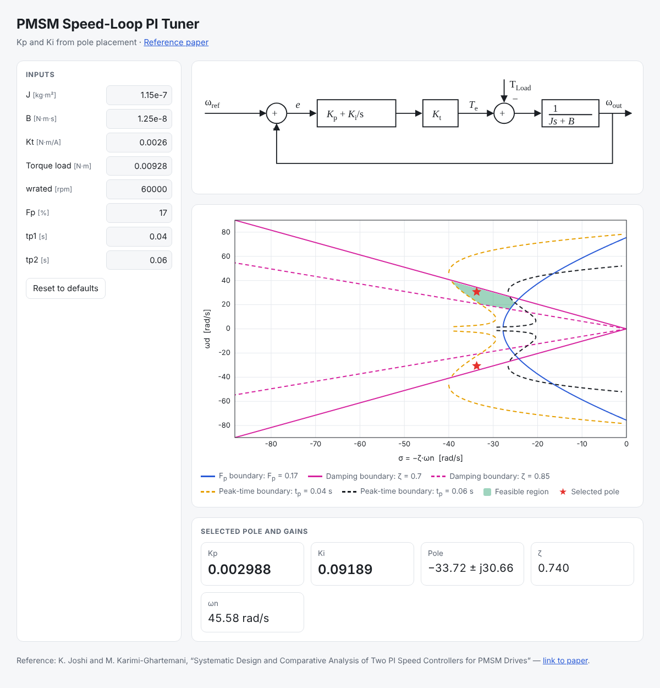

# PMSM Speed-Loop PI Tuner

A small web app that finds the PI gains **Kp** and **Ki** for the PMSM speed loop by pole placement. Enter the motor parameters and the specifications (`Fp`, `tp1`, `tp2`); the app plots the boundaries and returns one feasible pole with its gains.



**Theory and derivations:** see the paper

> K. Joshi and M. Karimi-Ghartemani, "Systematic Design and Comparative Analysis of Two PI Speed Controllers for PMSM Drives," [link to paper](https://doi.org/10.1109/SSCET69323.2026.11735668).

## Use

Open `index.html` in a browser, or host the folder with GitHub Pages. Nothing to install.

Inputs: `J`, `B`, `Kt`, `Torque load`, `wrated`, `Fp`, `tp1`, `tp2`.
Outputs: boundary plot, selected pole, `Kp`, `Ki`.

## Tests

```
node test/solver.test.js
```

## License

MIT, see [LICENSE](LICENSE).
